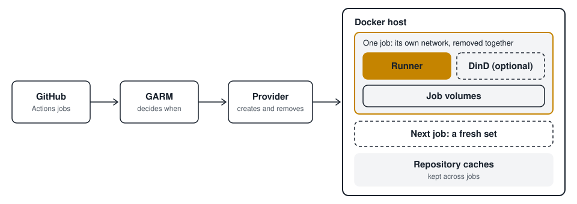

<p align="center">
  <picture>
    <source media="(prefers-color-scheme: dark)" srcset="docs/images/logo-dark.svg">
    
  </picture>
</p>

<h1 align="center">garm-provider-docker</h1>

<p align="center">
  Ephemeral GitHub Actions runners on a single Docker host, managed by
  <a href="https://github.com/cloudbase/garm">GARM</a>.<br>
  No Kubernetes or VMs needed.
</p>

<p align="center">
  <a href="https://github.com/TzuH-Hsu/garm-provider-docker/actions/workflows/ci.yml"></a>
  <a href="https://github.com/TzuH-Hsu/garm-provider-docker/actions/workflows/github-code-scanning/codeql"></a>
  <a href="https://github.com/TzuH-Hsu/garm-provider-docker/releases/latest"></a>
  <a href="go.mod"></a>
  <a href="LICENSE"></a>
  <a href="https://github.com/TzuH-Hsu?tab=packages&repo_name=garm-provider-docker"></a>
</p>

<p align="center">
  <a href="#quick-start">Quick start</a> ·
  <a href="#why-docker">Why Docker</a> ·
  <a href="#security-and-trust-boundary">Security</a> ·
  <a href="#documentation">Docs</a>
</p>

<p align="center">
  <picture>
    <source media="(prefers-color-scheme: dark)" srcset="docs/images/architecture-dark.svg">
    
  </picture>
</p>

GARM handles GitHub authentication, scale sets and scheduling. This provider
is the small executable GARM runs to create and remove runners. Give it a
machine with Docker and you have self-hosted runners with fresh resources for
every job.

## Highlights

- **A fresh set of resources for every job.** Each job gets its own bridge
  network, runner container and workspace volume, removed together when the
  job ends.
- **Docker-in-Docker only when you ask for it.** `allowed_dind_modes` defaults
  to `["none"]`, so a pool cannot get a privileged sidecar until you widen it.
- **Credentials stay off disk.** Runner credentials arrive through a
  memory-backed `tmpfs`, not environment variables. The host Docker socket is
  never mounted into a job.
- **Caches that survive between jobs.** Toolcache and pnpm store volumes persist
  per repository, and are never deleted automatically.
- **Ready-made runner images.** Ubuntu 24.04 and 26.04 images are published for
  `linux/amd64` and `linux/arm64`, with SBOM and provenance attestations.
- **No extra services.** One static binary that GARM runs when it needs it.

## Why Docker?

Pick this provider when you have one machine with Docker, you run jobs from
your own repositories, and you want fresh resources for every job without
operating a hypervisor or a cluster.

> [!WARNING]
> **Containers are not a security boundary against malicious job code.**
> Runners share the host's kernel, unlike VM-based providers. With
> `privileged-sidecar`, any job can get root on the host. Use this provider only
> for repositories whose workflows you trust, and never for public repositories
> or fork pull requests. See [Security and trust boundary](#security-and-trust-boundary).

| Provider type | What separates a job from the host | Good fit |
|---|---|---|
| **Docker container (this provider)** | Shares the host's kernel. `privileged-sidecar` gives jobs a route to the host | One machine, repositories you control |
| Kubernetes pod ([garm-provider-k8s](https://github.com/mercedes-benz/garm-provider-k8s)) | Shares the node's kernel, unless the cluster uses a sandboxed runtime | An existing Kubernetes cluster |
| VM ([LXD](https://github.com/cloudbase/garm-provider-lxd) or [Incus](https://github.com/cloudbase/garm-provider-incus) VMs, [cloud providers](https://github.com/cloudbase/garm/blob/main/doc/providers.md)) | Its own kernel, behind a hypervisor | Stronger isolation, or capacity beyond one machine |

## Quick start

You need a running [GARM](https://github.com/cloudbase/garm) with
[credentials](https://github.com/cloudbase/garm/blob/main/doc/credentials.md)
set up, and Docker on the same machine. GARM's user must be able to reach the
Docker socket.

**1. Install the binary.** Pick a version from the
[releases page](https://github.com/TzuH-Hsu/garm-provider-docker/releases).

```sh
VERSION=<version>   # for example v0.2.8
BASE=https://github.com/TzuH-Hsu/garm-provider-docker/releases/download/$VERSION
curl -fsSLO "$BASE/garm-provider-docker_${VERSION}_linux_amd64"
curl -fsSLO "$BASE/SHA256SUMS"
sha256sum --check --ignore-missing SHA256SUMS
sudo install -D -m 0755 "garm-provider-docker_${VERSION}_linux_amd64" \
  /opt/garm/providers.d/garm-provider-docker
```

**2. Write the provider config.** A pinned runner image is the only required
setting. Everything else has a default.

```sh
docker buildx imagetools inspect ghcr.io/tzuh-hsu/garm-runner-resolute:latest
```

```toml
# /etc/garm/garm-provider-docker.toml
runner_image = "ghcr.io/tzuh-hsu/garm-runner-resolute@sha256:<digest>"
```

**3. Register it in GARM's `config.toml`,** then restart GARM.

```toml
[[provider]]
  name = "docker_local"
  provider_type = "external"
  description = "Single-host Docker provider"

  [provider.external]
    provider_executable = "/opt/garm/providers.d/garm-provider-docker"
    config_file = "/etc/garm/garm-provider-docker.toml"
    interface_version = "v0.1.0"
```

**4. Create a scale set.** `--image` and `--flavor` are required by `garm-cli`
but ignored by this provider.

```sh
garm-cli scaleset add --repo <repo> --provider-name docker_local \
  --name docker-runners --image unused --flavor unused \
  --min-idle-runners 0 --max-runners 4 \
  --os-type linux --os-arch amd64 --enabled
```

**5. Use it in a workflow** with `runs-on: docker-runners`.

Running GARM in a container, or choosing another way to install? See
[Installation](docs/install.md).

## Security and trust boundary

**Use this provider only with repositories you control.** Do not attach public
repositories, or anything that runs workflows from fork pull requests. Runners
are containers, so they share the host's kernel.

| `dind_mode` | What job code gets | Containment |
|---|---|---|
| `none` (default) | An unprivileged container, no Docker daemon | Container isolation only |
| `privileged-sidecar` | A private Docker daemon in a privileged container | **None against malicious job code: it can get root on the host** |
| `sysbox-runc` | A private Docker daemon without `--privileged`; needs Sysbox on the host | Narrower than privileged; not covered by the live test |

Keep these in mind too:

- A host compromise reaches every job on the host, and GARM and its GitHub
  credentials if they run there. Keep high-value secrets off this host.
- Jobs have passwordless `sudo` inside their own container, and outbound
  network access by default.
- Jobs for the same repository share caches, so one job can affect a later one.
- Never let the host Docker daemon listen on TCP.

Read [ADR-001](docs/adr/ADR-001-dind-strategy.md) before enabling DinD. To report
a vulnerability, see [SECURITY.md](SECURITY.md).

## Verification status

The [live test](docs/demo-m0.md) runs real GitHub jobs through a real GARM. I
also run this provider for my own private repositories, on the first row's
setup.

| Setup | Status |
|---|---|
| GARM v0.2.1, scale sets, GitHub App, `interface_version` v0.1.0, amd64, Ubuntu 26.04 image, `none` and `privileged-sidecar` | Live-tested; last recorded release is v0.2.5 |
| Ubuntu 24.04 image | Last live-tested with v0.2.3 |
| Container jobs in `privileged-sidecar` | Live-tested on a pre-release build |
| `linux/arm64` | Published, not tested end to end |
| `sysbox-runc` | Unit tests only |
| Pools with webhooks, non-JIT runners, `interface_version` v0.1.1 with GARM | Not tested end to end |

## Compatibility

Use `interface_version = "v0.1.0"` on GARM v0.2.1 and earlier. GARM v0.2.1 has a
bug in its v0.1.1 `ListInstances` wrapper, fixed by
[cloudbase/garm#878](https://github.com/cloudbase/garm/pull/878) but not yet in a
release. The provider supports both interface versions.

On GARM v0.2.1, scale sets stall on a runner left at `pending`. The provider
narrows this by reporting runner status itself, and the upstream fix is
[cloudbase/garm#817](https://github.com/cloudbase/garm/pull/817). See
[How it works](docs/how-it-works.md#runner-status).

## Documentation

- [How it works](docs/how-it-works.md): job resources, DinD modes, caches, runner status
- [Installation](docs/install.md): binary, images, building from source, GARM in a container
- [Host requirements](docs/hosts.md): filesystems, address pools, capacity
- [Configuration reference](docs/config-reference.md) and [full example](examples/config.full.toml)
- [Runner images](runner-images/README.md)
- [Image pulls in DinD jobs](docs/dind-image-pulls.md) and [package store installs](docs/package-store-installs.md)
- [GARM provider contract](docs/garm-contract.md) and [design decisions](docs/adr/)

## Contributing

Issues and pull requests are welcome. See [CONTRIBUTING.md](CONTRIBUTING.md), and
[SUPPORT.md](SUPPORT.md) for where to ask questions.

Most of this code is written and reviewed with AI tools. I direct the design,
read the review findings and core code, test releases against a live GARM, and
decide what merges.

## License

[Apache-2.0](LICENSE)
